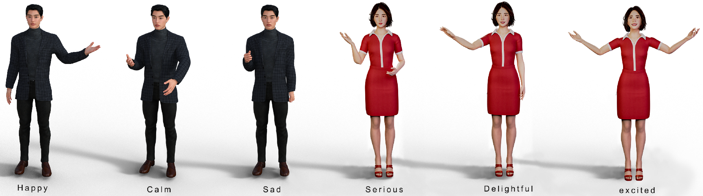
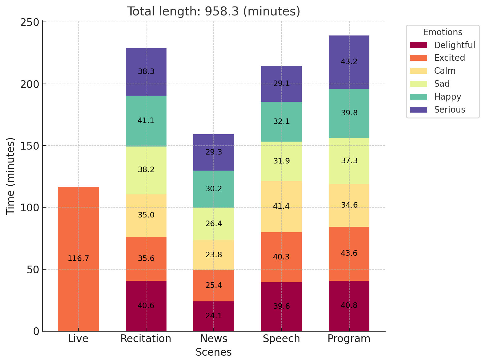
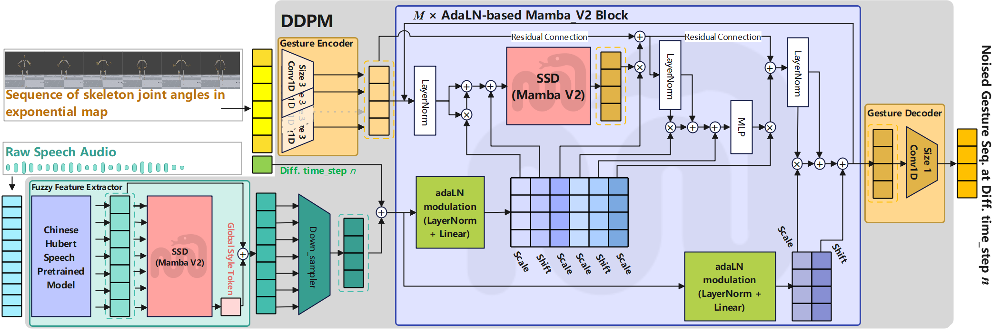
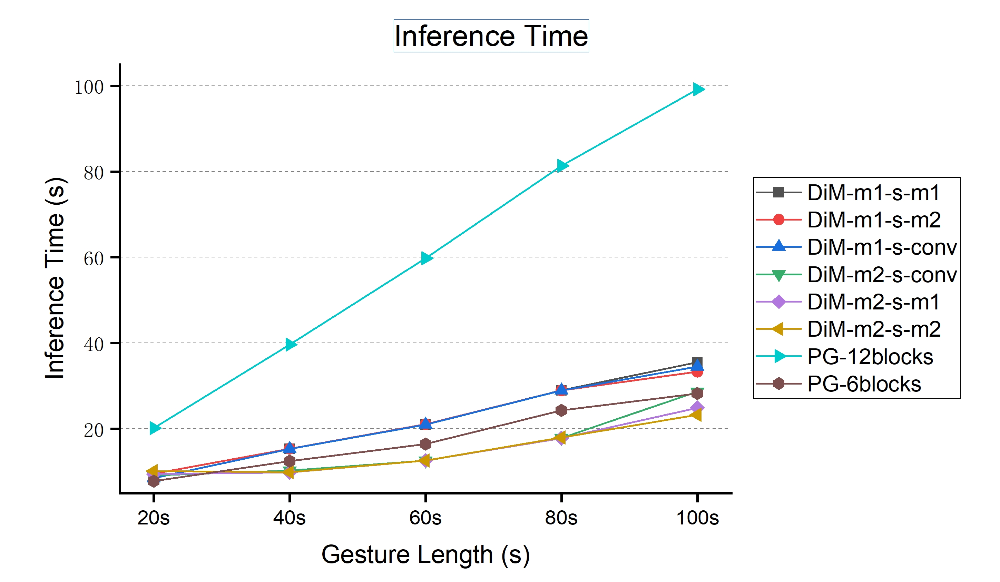
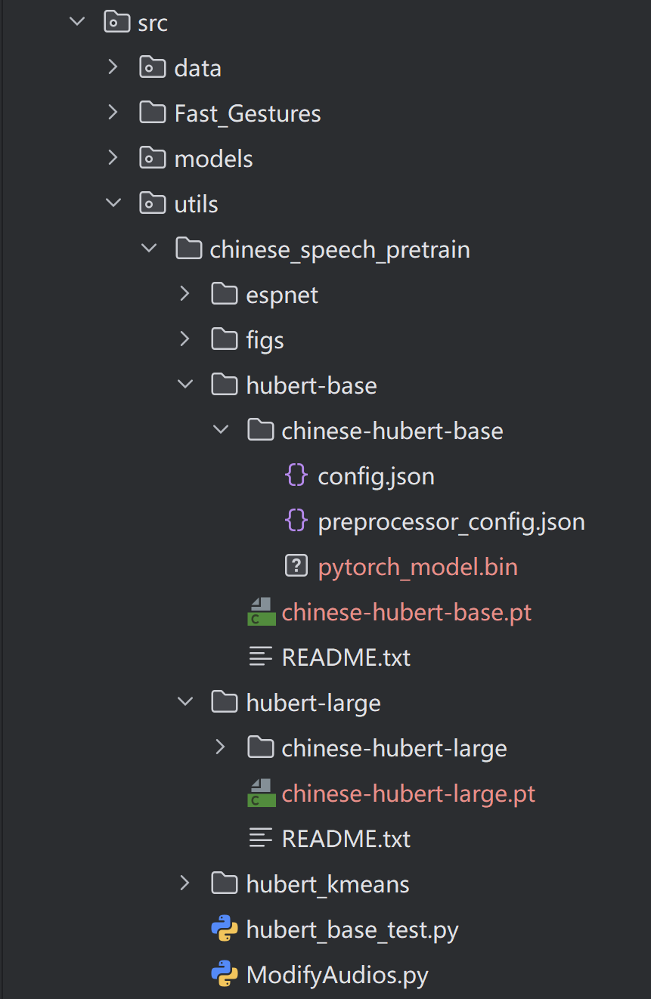
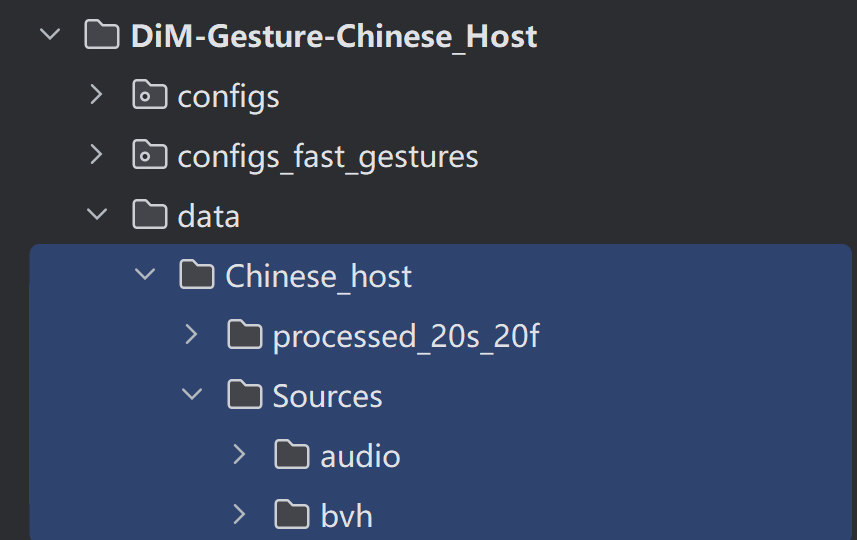

# DiM Gesture
## DiM-Gestor: Co-Speech Gesture Generation with Adaptive Layer Normalization Mamba-2
# Abstract
Speech-driven gesture generation using transformer-based generative models represents a rapidly advancing area within virtual human creation. However, existing models face significant challenges due to their quadratic time and space complexities, which limit scalability and efficiency. To address these limitations, we introduce **DiM-Gestor**, an innovative end-to-end generative model leveraging the Mamba-2 architecture. **DiM-Gestor** features a dual component framework: (1) a fuzzy feature extractor and (2) a speech-to-gestation mapping module, both built on Mamba-2. The fuzzy feature extractor, integrated with a Chinese Pre-trained Model and Mamba-2, autonomously extracts implicit, continuous speech features. These features are synthesized into a unified latent representation, which is then processed by the speech-to-gesture mapping module. This module employs an Adaptive Layer Normalization (AdaLN)-enhanced Mamba-2 mechanism to apply transformations across all sequence tokens uniformly. This enables precise modeling of the nuanced interplay between speech features and gesture dynamics. We utilize a diffusion model to train and infer diverse gesture outputs. Extensive subjective and objective evaluations conducted on the newly released Chinese Co-Speech Gestures dataset corroborate the efficacy of our proposed model. Compared with a Transformer-based architecture, the assessments reveal that our approach delivers competitive results, significantly reducing memory usage—approximately 2.4 times—and enhancing inference speeds by 2 to 4 times. Additionally, we released the CCG dataset, a Chinese Co-Speech Gestures dataset, comprising 15.97 hours (six styles in five scenarios) of 3D full-body skeleton gesture motion performed by professional Chinese TV broadcasters.





We propose **DiM-Gestor**, an end-to-end AdaLN Mamba-2 and diffusion-based architecture for co-speech gesture generation. In addition, we present the comprehensive Chinese Co-Speech Gestures (CCG) dataset, comprising 15.97 hours of full-body gesture motion performed by professional Chinese TV broadcasters. This dataset encompasses six distinct styles across five scenarios.



The architecture of DiM-Gestor incorporates a Mamba-2 fuzzy feature extractor and an Adaptive Layer Normalization (AdaLN) Mamba-2 diffusion architecture. The fuzzy feature extractor features a dual-component system engineered to capture the nuanced style and detailed audio features into unified latent features. These unified latent features are subsequently channeled into the AdaLN Mamba-2. This module is pivotal in modeling the intricate relationship between the incoming audio features and the corresponding gestures. It facilitates the estimation of diffusion noise within the diffusion model, ensuring the generation of diverse gestures. The overall schematic includes three main components: (a) Mamba-2 Fuzzy Feature Extractor, (b) Stack of AdaLN Mamba-2 Blocks, (c) Gestures Encoder and Decoder, and (d) Denoising Diffusion Probabilistic Model (DDPM).



The inference time of various gesture lengths across different architectures.

The experiment showcases are: https://drive.google.com/drive/folders/1NHFYAWW4UaQgVJlZkxnvkq4iGLfZ5eXk?usp=drive_link

# Environment
- Ubuntu 18.04
- Python 3.12
- CUDA 12
- pytorch-lightning 2.6.0

# Installations
We provide a requirements.txt for installation.
code:
```
git clone https://github.com/zf223669/DiMGestures.git
cd DiMGestures    # enter the project directory
conda create -n dm python==3.12
conda activate dm
pip install -r requirements.txt
```
# Install the Chinese_speech_pretain from:
https://github.com/TencentGameMate/chinese_speech_pretrain

to the ./src/utils/chinese_speech_pretrain, the files structure like:



# Download and set the dataset
Please download the Chinese_host dataset from the following link:  
https://drive.google.com/drive/folders/1LE9zOQiurpl2kH6-h6Ytk8rk4dFMWAtb?usp=drive_link  
After downloading, unzip the file.

Copy the audio and BVH folders into the ./data/Chinese_host/Sources directory. The resulting file structure should be as follows:



# Prepare the dataset to train:
```
python ./src/Fast_Gestures/Data_processing/prepare_datasets.py
```

# Train
```
python ./src/Fast_Gestures/trainer/train_fast_gestures.py -m experiment=Chinese_Host.yaml
```
# Inference
```
python ./src/Fast_Gestures/trainer/train_fast_gestures.py -m experiment=Chinese_Host_generation.yaml.yaml
```
You should specify the path to the checkpoint file in the `Chinese_Host_generation.yaml` file as follows:
```
ckpt_path: ./logs/Chinese_host/epoch_epoch=099.ckpt
```
The pretrained checkpoint is available for download at the following URL:
https://drive.google.com/drive/folders/17oyNomJw5yuqXfmsN7VyXyw4-hnVNDs4?usp=drive_link
# Note:
1. To train using the BEAT/ZEGGS dataset, please refer to the similar approach outlined in the PG section below.
2. You can install Mamba by yourself.(https://github.com/state-spaces/mamba)
# Reference
```
@INPROCEEDINGS{11291529,
  author={Zhang, Fan and Wei, Yi and Ji, Naye and Wu, Jingmei and Wang, Zhaohan and Gao, Fuxing and Zhang, Liuqing and Ye, Zhenqing and Yan, Leyao and Dai, Lanxin and Lyu, Xin and Yu, Dingguo and Jiang, Yanbing and Du, Hui and Zhao, Bozuo},
  booktitle={2025 International Conference on Computer Vision, Image Processing and Computational Photography (CVIP)(}, 
  title={DiM-Gestor: Co-Speech Gesture Generation with Adaptive Layer Normalization Mamba-2}, 
  year={2025},
  volume={},
  number={},
  pages={01-13},
  keywords={Photography;Adaptation models;Three-dimensional displays;TV;Scalability;Computer architecture;Feature extraction;Transformers;Skeleton;Faces;Speech-driven;Gesture synthesis;Gesture generation;AdaLN;Diffusion;Mamba},
  doi={10.1109/CVIP67348.2025.11291529}}
```
# Our previous work
 # PG 
Presentation page: https://zf223669.github.io/Diffmotion-v2-website/
```
@ARTICLE{zhang2024PersonalizedGesture,
  author={Zhang, Fan and Wang, Zhaohan and Lyu, Xin and Zhao, Siyuan and Li, Mengjian and Geng, Weidong and Ji, Naye and Du, Hui and Gao, Fuxing and Wu, Hao and Li, Shunman},
  journal={IEEE Transactions on Visualization and Computer Graphics}, 
  title={Speech-driven Personalized Gesture Synthetics: Harnessing Automatic Fuzzy Feature Inference}, 
  year={2024},
  volume={},
  number={},
  pages={1-16},
  keywords={Feature extraction;Transformers;Art;Synchronization;Semantics;Fuzzy logic;Adaptation models;Speech-driven;Gesture synthesis;Fuzzy inference;AdaLN;Diffusion;Transformer;DiTs},
  doi={10.1109/TVCG.2024.3393236}}
  ```
# Diffmotion
Presentation page: https://github.com/zf223669/DiffmotionGG-beta
```
@inproceedings{zhang2023diffmotion,
  title={DiffMotion: Speech-Driven Gesture Synthesis Using Denoising Diffusion Model},
  author={Zhang, Fan and Ji, Naye and Gao, Fuxing and Li, Yongping},
  booktitle={MultiMedia Modeling: 29th International Conference, MMM 2023, Bergen, Norway, January 9--12, 2023, Proceedings, Part I},
  pages={231--242},
  year={2023},
  organization={Springer}
}
```
